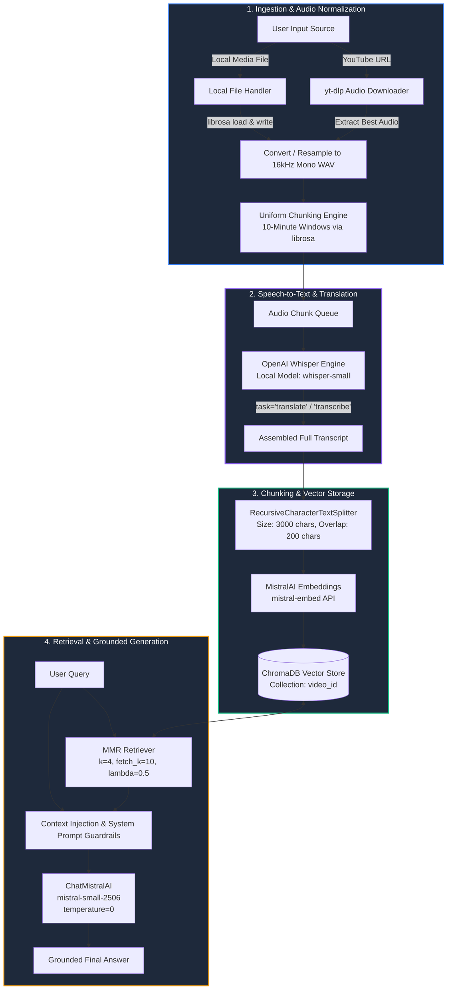
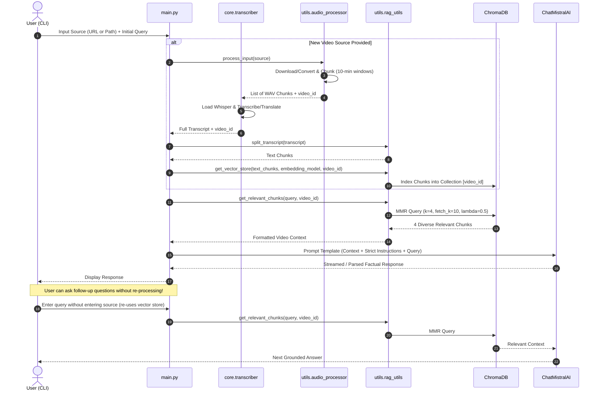

# AI Video Assistant (RAG)

<p align="center">
  
  
  
  
  
  
  
</p>

An enterprise-grade, retrieval-augmented intelligence assistant designed to transcribe, index, and answer complex natural language queries over video and audio content. Whether supplied with a remote YouTube URL or a local media file (`.mp4`, `.mkv`, `.wav`, `.mp3`), the pipeline automatically extracts the audio stream, segments large recordings into memory-bounded windows, performs automated speech-to-text (with optional multilingual translation) via **OpenAI Whisper**, indexes embeddings in **ChromaDB**, and generates strictly grounded, verifiable responses using **Mistral AI** and **LangChain**.

---

## Table of Contents

- [Key Features](#key-features)
- [System Architecture](#system-architecture)
  - [End-to-End Pipeline Flow](#end-to-end-pipeline-flow)
  - [Interactive Query Lifecycle](#interactive-query-lifecycle)
- [Technologies Used](#technologies-used)
- [Key Design Decisions](#key-design-decisions)
- [Project Structure](#project-structure)
- [Prerequisites](#prerequisites)
- [Setup & Installation](#setup--installation)
  - [1. Clone Repository](#1-clone-repository)
  - [2. Environment Setup](#2-environment-setup)
  - [3. Install Dependencies](#3-install-dependencies)
  - [4. Install FFmpeg](#4-install-ffmpeg)
  - [5. Configure Environment Variables](#5-configure-environment-variables)
- [Usage Guide](#usage-guide)
  - [Interactive Command-Line Interface](#interactive-command-line-interface)
  - [Sample Session](#sample-session)
- [Configuration Reference](#configuration-reference)
- [Troubleshooting](#troubleshooting)
- [Roadmap](#roadmap)
- [License](#license)

---

## Key Features

- **Dual-Source Ingestion**: Seamlessly downloads audio tracks from YouTube URLs via `yt-dlp` or converts local video/audio files to normalized 16 kHz mono WAV format.
- **Memory-Bounded Audio Chunking**: Automatically segments long recordings into configurable 10-minute windows via `librosa`, ensuring transcription stability without GPU/RAM exhaustion.
- **Multilingual Speech Recognition & Translation**: Utilizes OpenAI's Whisper model (`small` by default) with in-flight translation to English for foreign-language media.
- **Context-Preserving Vector Indexing**: Segments transcripts with `RecursiveCharacterTextSplitter` (3000-character windows, 200-character overlap) and computes dense embeddings using Mistral AI's `mistral-embed`.
- **Isolated Vector Collections**: Stores each media source under its own discrete ChromaDB collection keyed by video ID or sanitized filename, preventing cross-video context contamination.
- **Maximal Marginal Relevance (MMR) Retrieval**: Balances semantic proximity with informational diversity to eliminate redundant transcript citations.
- **Strict Anti-Hallucination Guardrails**: System prompt constrains Mistral AI to cite exclusively from the provided video transcript and transparently decline queries outside the source scope.
- **Persistent Multi-Turn Sessions**: Allows continuous conversational querying over the indexed video without triggering costly re-transcription.

---

## System Architecture

### End-to-End Pipeline Flow



### Interactive Query Lifecycle



---

## Technologies Used

| Category             | Technology                                                                              | Version / Spec     | Purpose in Architecture                                          |
| :------------------- | :-------------------------------------------------------------------------------------- | :----------------- | :--------------------------------------------------------------- |
| **Language Runtime** | [Python](https://www.python.org/)                                                       | `>= 3.10`          | Core runtime platform                                            |
| **LLM Inference**    | [Mistral AI](https://mistral.ai/) (`mistral-small-2506`)                                | API Endpoint       | Deterministic question answering with `temperature=0`            |
| **Dense Embeddings** | [Mistral AI](https://mistral.ai/) (`mistral-embed`)                                     | 1024-dim           | High-accuracy semantic embedding generation                      |
| **Orchestration**    | [LangChain](https://www.langchain.com/)                                                 | `>= 1.4.0`         | Prompt management, LCEL chaining, output parsing                 |
| **Vector Store**     | [ChromaDB](https://www.trychroma.com/) (`langchain-chroma`)                             | `>= 1.5.0`         | Local persistent vector storage with isolated collections        |
| **Speech-to-Text**   | [OpenAI Whisper](https://github.com/openai/whisper)                                     | `>= 20250625`      | Local speech-to-text transcription and cross-lingual translation |
| **Media Downloader** | [yt-dlp](https://github.com/yt-dlp/yt-dlp)                                              | `>= 2026.8.19`     | High-reliability extraction of audio tracks from YouTube URLs    |
| **Audio Processing** | [Librosa](https://librosa.org/) & [SoundFile](https://python-soundfile.readthedocs.io/) | Librosa `>= 1.0.0` | 16 kHz mono resampling, WAV encoding, and duration windowing     |
| **Audio Engine**     | [FFmpeg](https://ffmpeg.org/)                                                           | `>= 6.0` (System)  | Low-level decoding/encoding backend for yt-dlp and Whisper       |
| **Deep Learning**    | [PyTorch](https://pytorch.org/)                                                         | `>= 2.14.0`        | CUDA / CPU tensor engine powering Whisper inference              |
| **Configuration**    | [python-dotenv](https://github.com/theskumar/python-dotenv)                             | `>= 1.2.3`         | Secure local environment variable management                     |

---

## Key Design Decisions

### 1. Audio Segmentation (10-Minute Windows) with Librosa

- **Problem**: Full-length video files (such as 1-3 hour podcasts, lectures, or keynotes) easily trigger out-of-memory (OOM) exceptions in local ASR models and create high failure penalties if a connection or thread crashes midway.
- **Decision**: In [`utils/audio_processor.py`](file:///d:/Documents/Generative%20AI/AI-Video-Assistant-RAG/utils/audio_processor.py), incoming audio is normalized to 16,000 Hz mono and segmented into discrete 10-minute WAV windows before being fed into Whisper.
- **Benefits**:
  - Predictable, bounded memory consumption regardless of input file duration.
  - Granular progress reporting (e.g., `Transcribing chunk 2 of 6`).
  - High resilience: Individual failed chunks can be caught and retried independently.

### 2. Local Whisper Engine vs. Cloud ASR APIs

- **Problem**: Transcribing lengthy media files via commercial cloud APIs incurs significant recurring costs, latency overheads, and potential confidentiality violations for proprietary enterprise recordings.
- **Decision**: Implemented OpenAI's local open-weights `whisper` model in [`core/transcriber.py`](file:///d:/Documents/Generative%20AI/AI-Video-Assistant-RAG/core/transcriber.py).
- **Benefits**:
  - **Zero per-minute egress cost**: Unlimited local processing on CPU or GPU.
  - **Data Privacy**: Media files and transcripts never leave the local environment during ingestion.
  - **Automatic Translation**: By configuring `task="translate"`, foreign-language media is automatically translated directly into clean English text during the transcription pass.
  - **Configurability**: Model footprint can be scaled seamlessly via `WHISPER_MODEL` (`tiny`, `base`, `small`, `medium`, `large`).

### 3. Collection-Level Isolation per Video Identifier

- **Problem**: In multi-video systems, inserting all text chunks into a shared vector index leads to cross-video pollution, where questions intended for "Video A" inadvertently surface transcript excerpts from "Video B".
- **Decision**: Dynamic ChromaDB collection partitioning in [`utils/rag_utils.py`](file:///d:/Documents/Generative%20AI/AI-Video-Assistant-RAG/utils/rag_utils.py), indexing chunks under `collection_name=video_id` (derived from the YouTube video ID or sanitized local filename).
- **Benefits**:
  - Guarantees 100% isolation between distinct media sources.
  - Chunks can be retrieved, updated, or purged per video without rebuilding or scanning the entire vector database.

### 4. Maximal Marginal Relevance (MMR) Retrieval Strategy

- **Problem**: Standard cosine similarity search frequently retrieves 3-4 consecutive chunks that repeat the exact same sentence or thought, starving the LLM of necessary context from earlier or later sections of the video.
- **Decision**: Configured `as_retriever(search_type="mmr", search_kwargs={"k": 4, "fetch_k": 10, "lambda_mult": 0.5})`.
- **Benefits**:
  - `fetch_k=10` fetches the top 10 most semantically relevant chunks.
  - `lambda_mult=0.5` mathematically optimizes for a 50/50 balance between similarity to the question and orthogonal diversity across chunks.
  - Gives the LLM a holistic, non-redundant cross-section of the video to synthesize thorough answers.

### 5. Strict Anti-Hallucination & Grounded Prompt Engineering

- **Problem**: Large language models tend to interpolate their pre-trained parametric knowledge when asked questions about real-world events, misrepresenting what was actually said in the video.
- **Decision**: The system prompt in [`core/assist_pipeline.py`](file:///d:/Documents/Generative%20AI/AI-Video-Assistant-RAG/core/assist_pipeline.py) enforces:
  - "Use only the provided transcript to answer the query."
  - "Do not invent information that is not present in the transcript."
  - "If the transcript does not contain the answer, state that clearly."
  - "Do not mention the answer was referred from transcript - but mention it was referred from provided video."
- **Benefits**: Reliable, audit-compliant Q&A with zero fabricated facts and natural user attribution.

---

## Project Structure

```text
AI-Video-Assistant-RAG/
│
├── core/
│   ├── assist_pipeline.py      # LangChain RAG pipeline (prompt template, chain, & answer synthesis)
│   └── transcriber.py          # OpenAI Whisper model loader, chunk iteration, & translation logic
│
├── utils/
│   ├── audio_processor.py      # yt-dlp downloader, 16kHz WAV converter, & 10-minute audio chunker
│   ├── model.py                # ChatMistralAI initialization (model="mistral-small-2506", temp=0)
│   └── rag_utils.py            # RecursiveCharacterTextSplitter, ChromaDB vector store, & MMR retriever
│
├── downloads/                  # Default output directory for downloaded & extracted audio files
├── chroma_db/                  # Local persistent Chroma vector store directory (auto-created)
│
├── main.py                     # Interactive CLI entrypoint & conversational loop
├── test.py                     # Standalone verification script for rapid pipeline testing
├── requirements.txt            # Locked project dependencies and library versions
├── .env.example                # Sample environment configuration template
├── .env                        # Local API keys and runtime parameters (git-ignored)
├── .gitignore                  # Git ignore rules for virtualenvs, downloads, and secrets
├── LICENSE                      # MIT open-source license
└── README.md                   # Complete architectural and operational documentation
```

---

## Prerequisites

Before setting up the project, ensure your workstation satisfies the following requirements:

1. **Python 3.10+**: Confirm your version via `python --version`.
2. **FFmpeg**: Required on your system path for audio stream extraction and Whisper processing.
3. **Mistral AI Account**: An active API key with access to `mistral-small` and `mistral-embed` ([Get API Key](https://console.mistral.ai/)).
4. **Hardware (Optional but Recommended)**: NVIDIA GPU with CUDA support for accelerated Whisper transcription. CPU inference is fully supported out of the box.

---

## Setup & Installation

### 1. Clone Repository

```bash
git clone https://github.com/aasif-10/AI-Video-Assistant-RAG.git
cd AI-Video-Assistant-RAG
```

### 2. Environment Setup

Create and activate an isolated Python virtual environment:

#### Windows (PowerShell)

```powershell
python -m venv .venv
.\.venv\Scripts\Activate.ps1
```

#### Windows (Command Prompt)

```cmd
python -m venv .venv
.\.venv\Scripts\activate.bat
```

#### macOS / Linux

```bash
python3 -m venv .venv
source .venv/bin/activate
```

### 3. Install Dependencies

Upgrade package managers and install the dependencies from `requirements.txt`:

```bash
pip install --upgrade pip
pip install -r requirements.txt
```

> **Note on PyTorch & CUDA**: If you have an NVIDIA GPU and wish to leverage CUDA acceleration for Whisper, install PyTorch with CUDA support following the [official PyTorch installation matrix](https://pytorch.org/get-started/locally/):
>
> ```bash
> pip install torch --index-url https://download.pytorch.org/whl/cu121
> ```

### 4. Install FFmpeg

FFmpeg must be installed and discoverable by Python.

- **Windows**:
  - Install via Chocolatey: `choco install ffmpeg`
  - Install via Scoop: `scoop install ffmpeg`
  - Or download the static build from [gyan.dev](https://www.gyan.dev/ffmpeg/builds/) and add the `bin` directory to your system environment `PATH`.
    > _Note: If installed in a non-standard location (e.g. `D:\ffmpeg\...`), update the paths in `core/transcriber.py` and `utils/audio_processor.py` or append it to system `PATH`._

- **macOS**:

  ```bash
  brew install ffmpeg
  ```

- **Linux (Ubuntu/Debian)**:
  ```bash
  sudo apt update && sudo apt install -y ffmpeg
  ```

### 5. Configure Environment Variables

Create your local `.env` configuration file from the provided template:

```bash
cp .env.example .env
```

Open `.env` in your editor and enter your credentials:

```env
# Mistral API key for LLM generation and Text Embeddings
MISTRAL_API_KEY=your_actual_mistral_api_key_here

# Whisper Configuration: tiny | base | small | medium | large
WHISPER_MODEL=small
```

---

## Usage Guide

### Interactive Command-Line Interface

Launch the assistant:

```bash
python main.py
```

### Sample Session

```text
AI Video Assistant

Enter the source or upload local file of audio/video: https://youtu.be/example123
Enter query: What are the three primary takeaways discussed by the speaker?

Detected youtube URL, downloading audio!
[youtube] Extracting URL: https://youtu.be/example123
[download] 100% of 15.20MiB in 00:01
Video downloaded!!

Chunking audio
Audio is ready, 2 chunks created

Loading model
Model loaded

Transcribing chunk 1
Transcribing chunk 2
Transcription completed

Splitting transcript
Creating and storing transcript chunks in vector
Retrieving relevant chunks

Based on the provided video, the speaker highlights three primary takeaways:
1. Retrieval-Augmented Generation bridges the gap between static model weights and dynamic private knowledge.
2. Chunk diversity using MMR prevents semantic duplication in retrieved prompt contexts.
3. Audio segmentation prior to transcription prevents GPU memory overflow on long media.

Enter the source or upload local file of audio/video:
Enter query: Does the speaker mention anything about fine-tuning costs?

Retrieving relevant chunks

According to the provided video, the speaker mentions that fine-tuning is significantly more expensive and less agile for rapidly updating documentation compared to retrieval augmentation.

Enter the source or upload local file of audio/video:
Enter query: exit

Exiting...!
```

> **Pro Tip**: Notice how pressing Enter on `source` for subsequent queries skips re-downloading and re-transcription! The assistant queries the existing ChromaDB collection immediately.

---

## Configuration Reference

| Variable          | Default      | Allowed Values                             | Description                                                                                 |
| :---------------- | :----------- | :----------------------------------------- | :------------------------------------------------------------------------------------------ |
| `MISTRAL_API_KEY` | _(Required)_ | Alphanumeric string                        | API token from Mistral AI Console.                                                          |
| `WHISPER_MODEL`   | `small`      | `tiny`, `base`, `small`, `medium`, `large` | Local Whisper model weight variant. `small` provides optimal balance of speed and accuracy. |
| `chunk_size`      | `3000`       | Positive Integer                           | Transcript character window size in `RecursiveCharacterTextSplitter`.                       |
| `chunk_overlap`   | `200`        | Positive Integer                           | Overlapping character count between consecutive transcript chunks.                          |
| `chunk_minutes`   | `10`         | Positive Integer                           | Duration in minutes for audio segmentation in `chunk_audio()`.                              |
| `lambda_mult`     | `0.5`        | `0.0` - `1.0`                              | MMR diversity factor (`1.0` = pure similarity, `0.0` = maximum diversity).                  |

---

## Troubleshooting

### 1. `FileNotFoundError: [WinError 2] The system cannot find the file specified` (FFmpeg)

- **Cause**: Whisper or `yt-dlp` cannot locate `ffmpeg.exe` on system `PATH`.
- **Solution**: Confirm FFmpeg is installed and verify by running `ffmpeg -version` in your terminal. If using a custom installation folder, ensure `os.environ["PATH"] += ...` points to your correct `bin` folder in [`core/transcriber.py`](file:///d:/Documents/Generative%20AI/AI-Video-Assistant-RAG/core/transcriber.py) and [`utils/audio_processor.py`](file:///d:/Documents/Generative%20AI/AI-Video-Assistant-RAG/utils/audio_processor.py).

### 2. CUDA Out of Memory with Whisper

- **Cause**: Using a large Whisper model (e.g. `medium` or `large`) on a GPU with limited VRAM (<6GB).
- **Solution**: Change `WHISPER_MODEL=small` or `WHISPER_MODEL=base` in your `.env` file, or set `chunk_minutes=5` in [`utils/audio_processor.py`](file:///d:/Documents/Generative%20AI/AI-Video-Assistant-RAG/utils/audio_processor.py).

### 3. Mistral Authentication Error (`401 Unauthorized`)

- **Cause**: Missing or invalid `MISTRAL_API_KEY`.
- **Solution**: Verify your API key at [Mistral AI Console](https://console.mistral.ai/) and verify that your `.env` file is positioned at the project root directory.

### 4. YouTube Download Errors (`yt-dlp: Signature extraction failed`)

- **Cause**: Outdated `yt-dlp` package facing YouTube anti-bot changes.
- **Solution**: Run `pip install --upgrade yt-dlp` to pull the latest cipher extractors.

---

## Roadmap

- [ ] **Streamlit / Gradio Web UI**: Visual media player with synchronized timestamp jumping to cited transcript segments.
- [ ] **Timestamped Metadata**: Attach exact MM:SS video timecodes to chunks so answers cite specific timestamps.
- [ ] **Hybrid Search**: Combine BM25 keyword matching with dense Mistral embeddings for superior entity retrieval.
- [ ] **Asynchronous Chunk Processing**: Parallelize Whisper chunk transcription across multi-GPU setups.
- [ ] **Local LLM Fallback**: Support local inference via Ollama (`llama3`, `mistral`) for 100% air-gapped deployments.

---

## License

This project is licensed under the [MIT License](LICENSE) - feel free to use, modify, and distribute it for personal and commercial projects.
